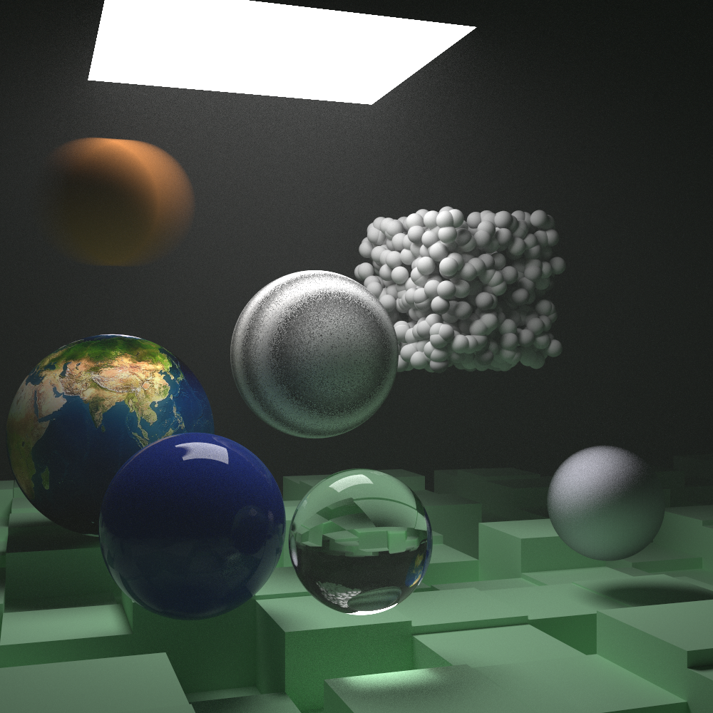
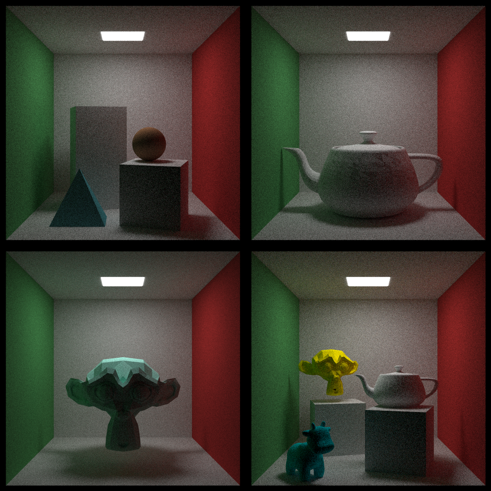
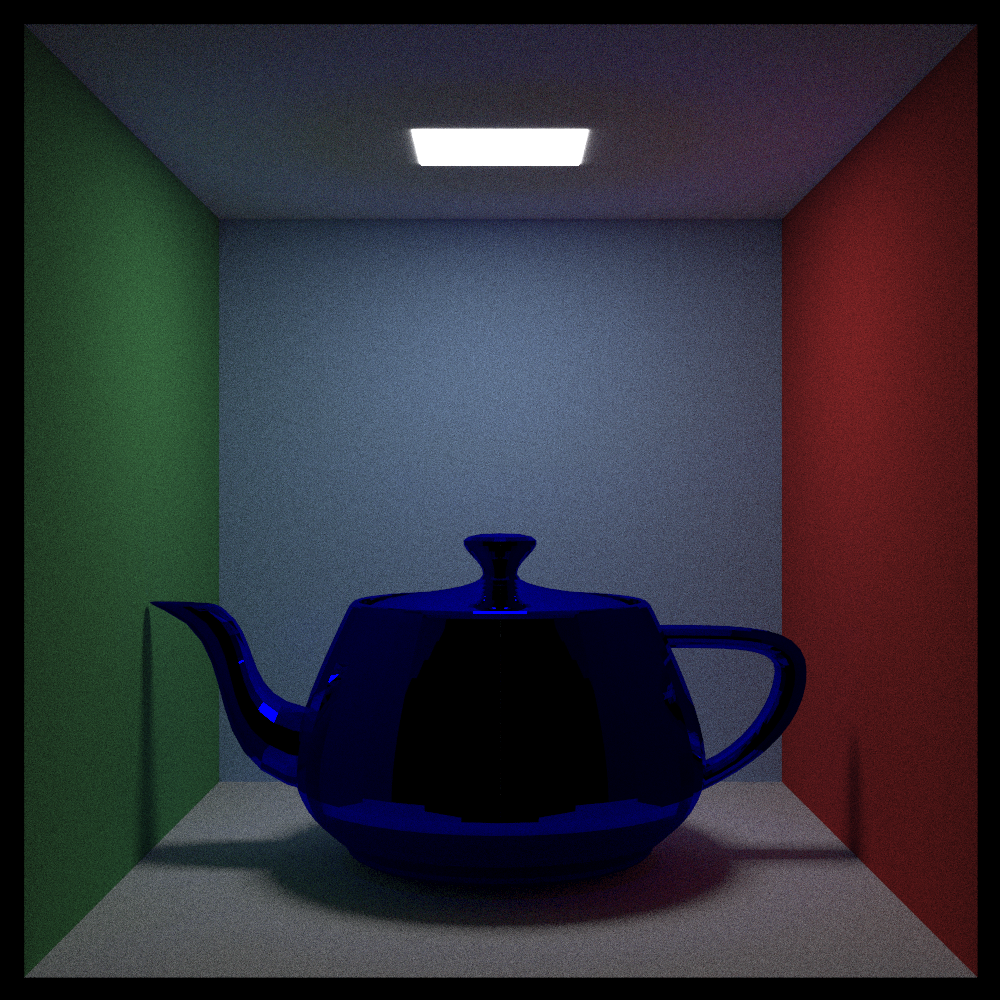
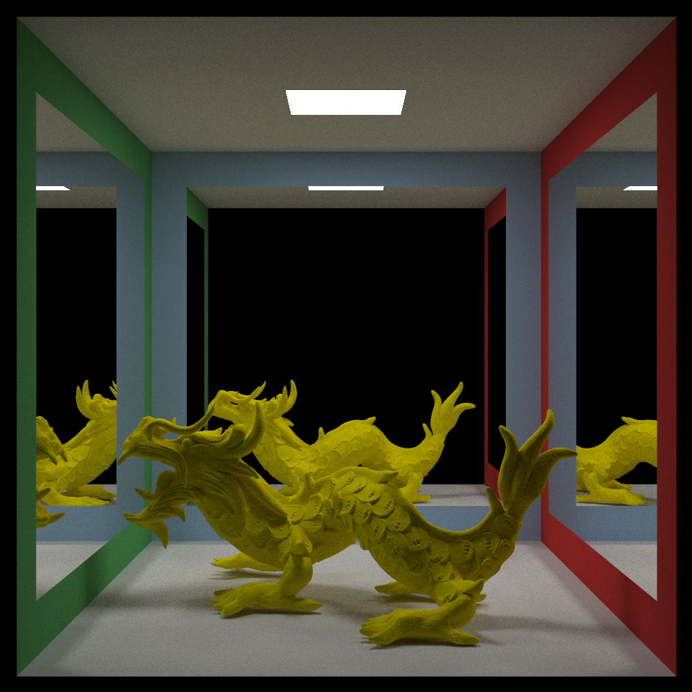
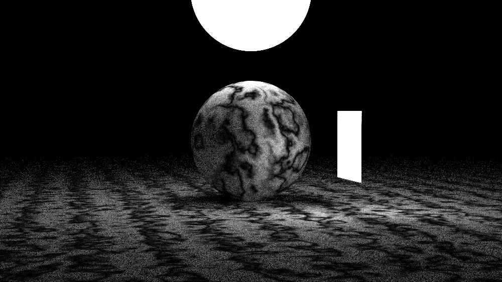
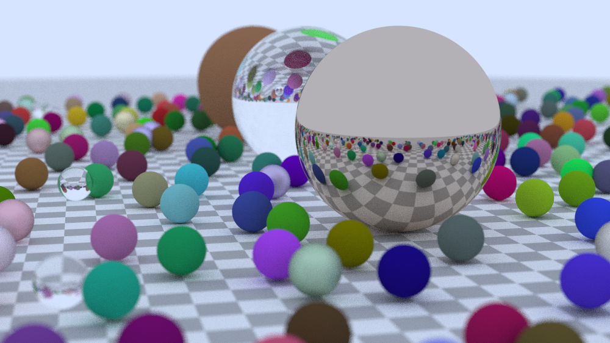

# Ray Tracing in One Weekend, in modern C++
An optimized implementation of Peter Shirley’s classic ray tracing (actually path tracing) series: [*Ray Tracing in One Weekend*](https://raytracing.github.io/books/RayTracingInOneWeekend.html) [*Ray Tracing: The Next Week*](https://raytracing.github.io/books/RayTracingTheNextWeek.html) and [*Ray Tracing: The Rest of Your Life*](https://raytracing.github.io/books/RayTracingTheRestOfYourLife.html). This version is written in C++17 and uses OpenMP multithreading for better performance.

### Preview:








## Features Added

Peter Shirley’s originals were intentionally C-style. This project reimagines them with modern C++ practices and performance optimizations.

Some features added:
- Importance sampling (book 3, extended): cosine-weighted diffuse bounces plus direct light sampling with shadow rays, combined with multiple importance sampling (power heuristic), and stratified pixel samples. Book 3's 50/50 mixture pdf has no shadow ray, so lights hidden behind glass or other objects caused fireflies; MIS removes them. Pass the scene's lights with `camera.render(world, lights)`.
- A 3D model importer.
- Generic vector class: a small `Vector<T, N>` template (`vec3f`, `point3f` and `color` are `Vector<float, 3>`).
- Image Writer: Instead of relying on a PPM writer, which is very slow and produces very large files, I implemented an image writer using stb_image_write. It supports multiple output formats, including PPM, PNG, JPEG, BMP, and TGA.
- Multithreading: Initially, I implemented a custom thread pool, but later transitioned to OpenMP for simplicity and better performance (skill issue on my part).
- 4-wide BVH: the tree is built with the surface area heuristic (binned SAH), then collapsed so every node holds four children, and a ray is tested against all four boxes at once with SSE. This is 1.1–1.4x faster than the binary BVH, depending on the scene.
- SIMD only where it pays off: an SSE `vec3` was also tried, but with `-O3 -march=native` it was within ±15% of the plain version (faster on some scenes, slower on others), so `Vector` stays plain C++. The BVH is the one place with hand-written SSE, which means the project builds for x86-64 only.

## Building with CMake
### External (header-only) dependencies
- [stb_image_write.h](https://github.com/nothings/stb/blob/master/stb_image_write.h)
- [stb_image.h](https://github.com/nothings/stb/blob/master/stb_image.h)
- [tiny_obj_loader.h](https://github.com/tinyobjloader/tinyobjloader)

### Requirements
- C++17 (GCC >= 9 or Clang >= 10)
- [CMake](https://cmake.org/)
- OpenMP support

### Build Instructions
```bash
# Clone the repository
git clone https://github.com/hilbertcube/SIMD-Pathtracer.git
cd SIMD-Pathtracer

# Create a build directory
mkdir build && cd build

# Configure the project
cmake .. -DCMAKE_BUILD_TYPE=Release

# Build the project
cmake --build .
```

### Running

Run from the repository root, since scenes load `model/` and `texture/` from there:
```bash
./build/main [scene] [output_directory]
./build/main 7             # render scene 7 (the Cornell box) to images/cornell_box.png
./build/main 7 renders     # same, but write to renders/cornell_box.png
```
The number picks a case of the `switch` in `main()` in [src/main.cpp](src/main.cpp): 1 spheres, 2 checkered spheres, 3 earth, 4 Perlin spheres, 5 quads, 6 simple light, 7 Cornell box, 8 Book 2 final scene, 9 teapot model (the default), 10 multiple models, 11 dragon (a 250k-triangle model), 12 sculpture gallery, 13 neon stage, 14 bunny campfire; any other number renders a quick preview of the final scene.

Images go to `images/` unless another directory is given (it is created if missing). Rendering a scene there replaces the existing image of the same name. Each scene sets its own `output_filename`, and the extension picks the format (`.png`, `.jpg`, `.bmp`, `.tga` or `.ppm`).

## Future plans
- CUDA acceleration
- Command line arguments