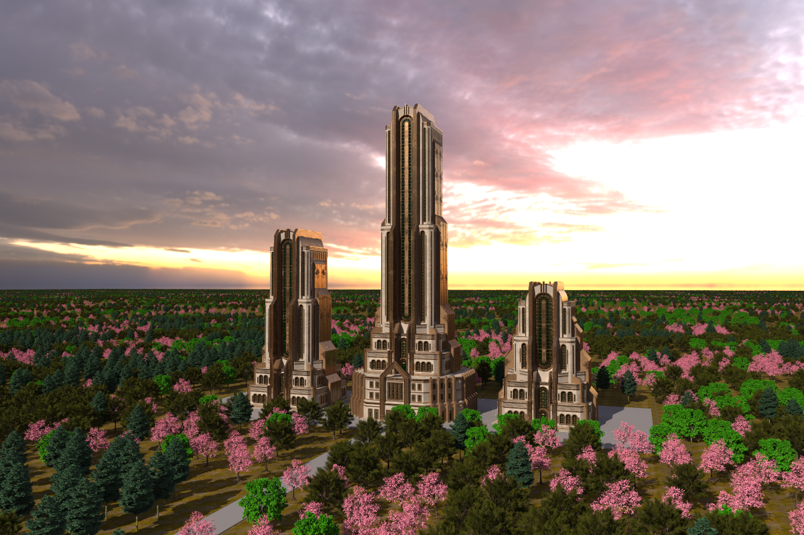

# Yet Another C++ Path Tracer

A CPU path tracer in C++17 with OpenMP. Started from Peter Shirley's [*Ray Tracing in One Weekend*](https://raytracing.github.io/books/RayTracingInOneWeekend.html) series ([book 2](https://raytracing.github.io/books/RayTracingTheNextWeek.html), [book 3](https://raytracing.github.io/books/RayTracingTheRestOfYourLife.html)) then goes well beyond it.




## Features

- **Lighting:** direct light sampling with shadow rays, combined with material sampling by multiple importance sampling (MIS), plus Russian roulette and stratified pixel samples
- **Materials:** diffuse, Oren-Nayar, metal, GGX conductors, brushed metal, glass (smooth, frosted, tinted, dispersive), coated plastic, iridescent, velvet, bump mapping, emissive, and participating media (smoke, mist, glowing, subsurface-like)
- **Models:** OBJ loading with textures, normals, smooth shading and per-part materials, with scenes of up to 700k triangles
- **Speed:** a 4-wide SSE BVH built with the surface area heuristic, and OpenMP across all cores
- **Denoising:** optional [Intel Open Image Denoise](https://www.openimagedenoise.org/), so a 64-sample render looks close to a 1000-sample one
- **Output:** PNG, JPEG, BMP or TGA

## Build

Requirements: a C++17 compiler (GCC 9+ or Clang 10+), [CMake](https://cmake.org/) 3.18+ and OpenMP. The BVH uses SSE, so it builds for x86-64 only.

```bash
git clone https://github.com/hilbertcube/Yet-Another-Path-Tracer.git
cd Yet-Another-Path-Tracer

cmake -S . -B build -DCMAKE_BUILD_TYPE=Release
cmake --build build -j
```

**Always build in Release.** A Debug build renders about 10 times slower. To check an existing build folder:

```bash
grep CMAKE_BUILD_TYPE build/CMakeCache.txt     # should say Release
```

### Optional: denoiser

Download the Linux tarball from the [Open Image Denoise releases](https://github.com/RenderKit/oidn/releases), unpack it into `third_party/oidn/`, and run the configure step again. Without it everything works except `--denoise`.

## Run

Run from the repository root, since the scenes load `models/` and `texture/` from there. The scenes with models need them downloaded, since they are not in the repository: [models/README.md](models/README.md) says where to get each one.

```bash
./build/main scene.lua [output_directory] [--spp N] [--width N] [--denoise]
```

```bash
./build/main scenes/18_mustang.lua                                  # render to images/mustang.png
./build/main scenes/18_mustang.lua renders                          # same, but into renders/
./build/main scenes/18_mustang.lua --spp 64 --denoise               # a quick, clean preview
./build/main scenes/18_mustang.lua --width 320 --spp 16 --denoise   # a rough one, to check a layout
```

### Scenes

| Script | Scene | Script | Scene |
| --- | --- | --- | --- |
| `01_spheres.lua` | Spheres | `10_multiple_models.lua` | Multiple models |
| `02_checkered_spheres.lua` | Checkered spheres | `11_dragon.lua` | Dragon (250k triangles) |
| `03_earth.lua` | Earth | `12_sculpture_gallery.lua` | Sculpture gallery |
| `04_perlin_spheres.lua` | Perlin spheres | `13_neon_stage.lua` | Neon stage |
| `05_quads.lua` | Quads | `14_bunny_campfire.lua` | Bunny campfire |
| `06_simple_light.lua` | Simple light | `15_christmas.lua` | Christmas |
| `07_cornell_box.lua` | Cornell box | `16_material_showcase.lua` | Material showcase |
| `08_final_scene.lua` | Book 2 final scene | `17_kitchen.lua` | Kitchen |
| `09_teapot.lua` | Teapot | `18_mustang.lua` | Mustang |
| | | `19_building.lua` | Art Deco towers |

The scripts from `09_teapot.lua` on need models.

## Profiling

`tools/profile.sh` renders a scene under Linux [perf](https://perfwiki.github.io/) and draws a flame graph of where the time goes. It needs `perf` and Perl.

```bash
tools/profile.sh                                   # scenes/09_teapot.lua at 32 samples per pixel
tools/profile.sh scenes/11_dragon.lua --spp 16     # any scene, with any options for main
```

It builds a separate binary with frame pointers and debug symbols in `build-profile/`, then writes `profile/<scene>.svg` and prints the functions with the most self time. Open the SVG in a browser: click a frame to zoom into it, hover for sample counts, and press Ctrl+F to search for a function.

The graph is drawn by Brendan Gregg's [FlameGraph](https://github.com/brendangregg/FlameGraph) scripts. Download them once with `tools/fetch_flamegraph.sh`, which puts them in `third_party/FlameGraph/` (not committed).

## Credits

### Books

- Peter Shirley, Trevor David Black and Steve Hollasch, [*Ray Tracing in One Weekend*](https://raytracing.github.io/) series: the starting point of this project
- Matt Pharr, Wenzel Jakob and Greg Humphreys, [*Physically Based Rendering*](https://pbr-book.org/): the BVH chapter (SAH buckets, flattened tree, ordered traversal) and the material and sampling chapters

### BVH and SIMD traversal

- Goldsmith & Salmon (1987) and MacDonald & Booth (1990): the surface area heuristic
- Ingo Wald (2007), "On fast Construction of SAH-based Bounding Volume Hierarchies": binned SAH building
- Dammertz, Hanika & Keller (2008), "Shallow Bounding Volume Hierarchies for Fast SIMD Ray Tracing of Incoherent Rays", and Ernst & Greiner (2008), "Multi Bounding Volume Hierarchies": the 4-wide SIMD BVH
- Williams, Barrus, Morley & Shirley (2005), "An Efficient and Robust Ray–Box Intersection Algorithm": picking the near and far slab from the ray direction's sign
- Thiago Ize (2013), "Robust BVH Ray Traversal" (JCGT): floating-point robustness of slab tests
- Tavian Barnes, [Fast, Branchless Ray/Bounding Box Intersections](https://tavianator.com/): NaN and infinity handling with SSE min/max
- Jacco Bikker, [How to build a BVH](https://jacco.ompf2.com/) blog series and [tinybvh](https://github.com/jbikker/tinybvh)
- Intel [Embree](https://github.com/RenderKit/embree): a production example of wide SIMD BVHs

### Third-party libraries and tools

- [stb](https://github.com/nothings/stb): image loading and writing (in `third_party/`)
- [tinyobjloader](https://github.com/tinyobjloader/tinyobjloader): OBJ loading (in `third_party/`)
- [Lua](https://www.lua.org) 5.4: runs the scene scripts (in `third_party/lua/`, MIT license)
- [sol2](https://github.com/ThePhD/sol2) 3.3.0: binds the renderer to Lua (in `third_party/sol2/`, MIT license)
- [Intel Open Image Denoise](https://www.openimagedenoise.org/): the optional `--denoise` step
- [OpenMP](https://www.openmp.org/): multithreading
- Brendan Gregg's [FlameGraph](https://github.com/brendangregg/FlameGraph): profiling graphs

### Models

- See [models/README.md](models/README.md) for the origin of each model, grouped by source

### Textures

- [Poly Haven](https://polyhaven.com/) (CC0): the Belfast Sunset (Pure Sky) sky and the Aerial Grass Rock texture in `texture/`, used by the Art Deco towers scene

## Future plans

- GPU rendering
