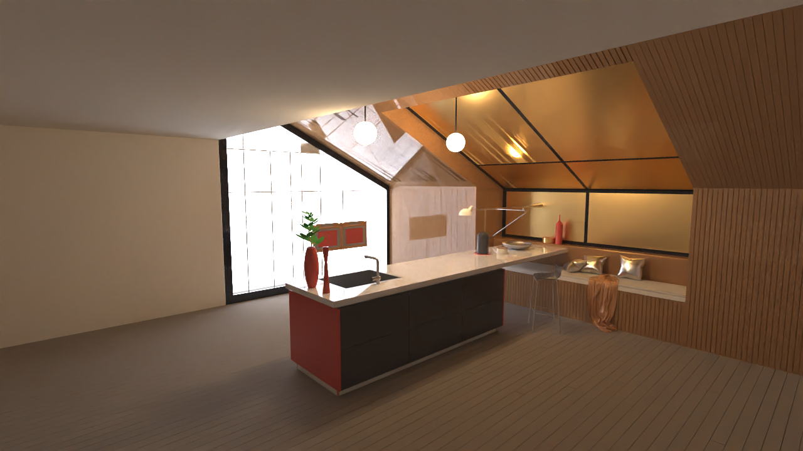
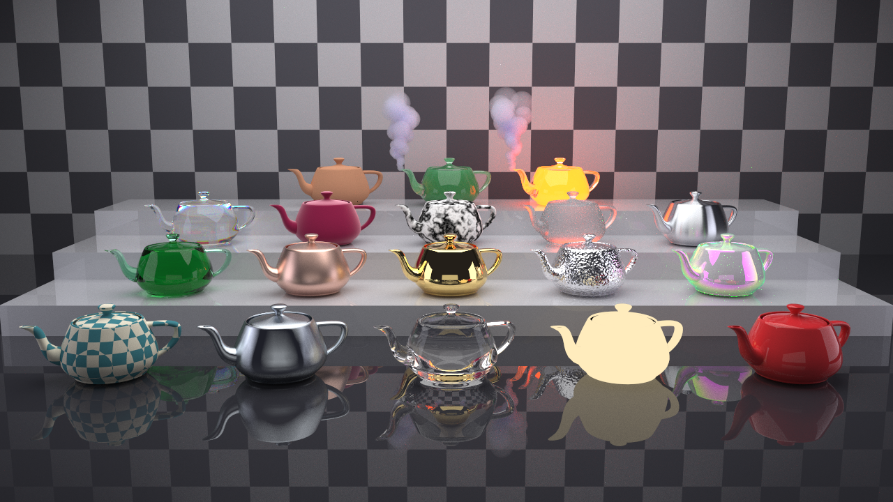
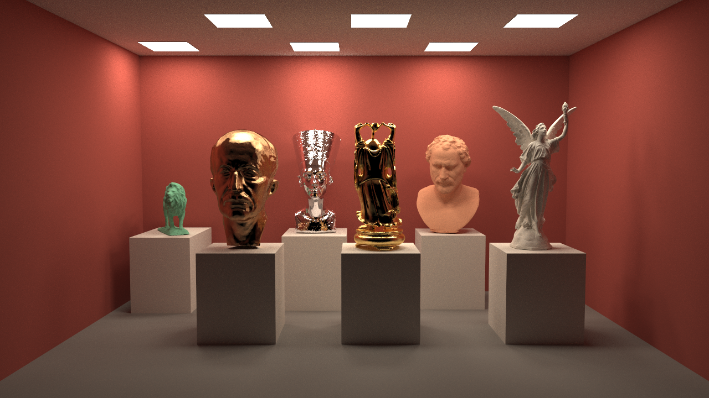
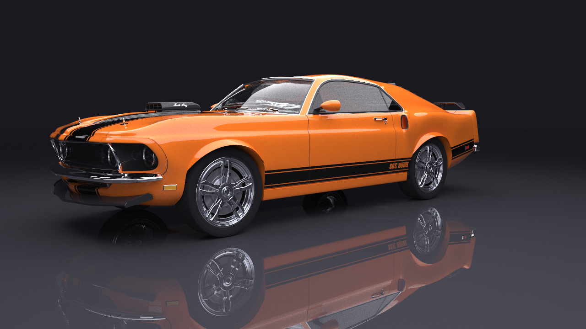
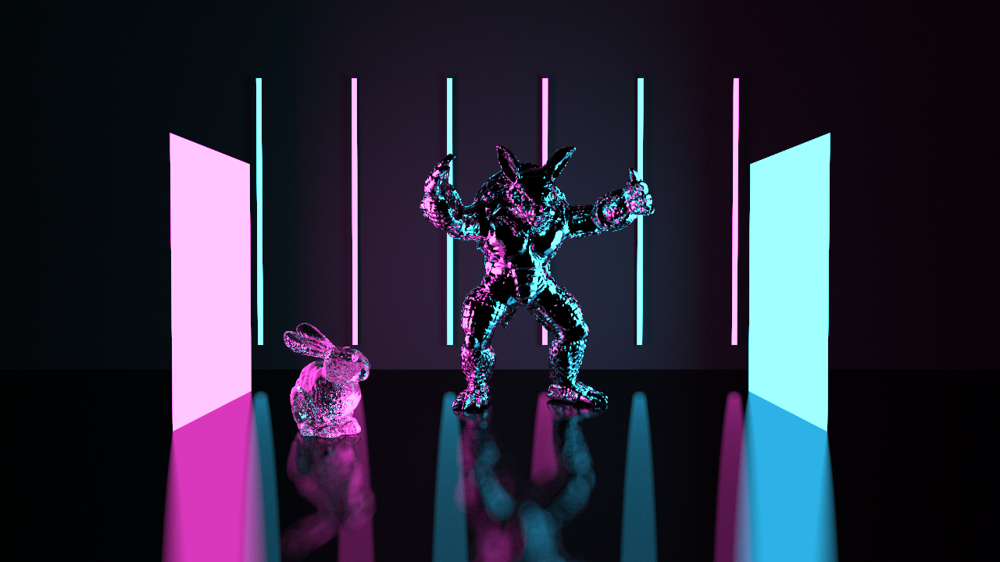
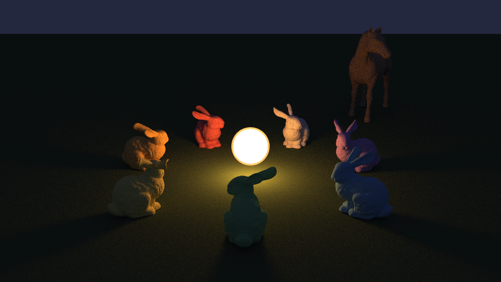

# Path Tracer in C++

A CPU path tracer in C++17 with OpenMP. It started from Peter Shirley's [*Ray Tracing in One Weekend*](https://raytracing.github.io/books/RayTracingInOneWeekend.html) series ([book 2](https://raytracing.github.io/books/RayTracingTheNextWeek.html), [book 3](https://raytracing.github.io/books/RayTracingTheRestOfYourLife.html)) and goes well beyond it.










## Features

- **Lighting:** direct light sampling with shadow rays, combined with material sampling by multiple importance sampling (MIS), plus Russian roulette and stratified pixel samples
- **Materials:** diffuse, Oren-Nayar, metal, GGX conductors, brushed metal, glass (smooth, frosted, tinted, dispersive), coated plastic, iridescent, velvet, bump mapping, emissive, and participating media (smoke, mist, glowing, subsurface-like)
- **Models:** OBJ loading with textures, normals, smooth shading and per-part materials, with scenes of up to 700k triangles
- **Speed:** a 4-wide SSE BVH built with the surface area heuristic, and OpenMP across all cores
- **Denoising:** optional [Intel Open Image Denoise](https://www.openimagedenoise.org/), so a 64-sample render looks close to a 1000-sample one
- **Output:** PNG, JPEG, BMP or TGA

## Build

You need a C++17 compiler (GCC 9+ or Clang 10+), [CMake](https://cmake.org/) 3.18+ and OpenMP. The BVH uses SSE, so it builds for x86-64 only.

```bash
git clone https://github.com/hilbertcube/SIMD-Pathtracer.git
cd SIMD-Pathtracer

cmake -S . -B build -DCMAKE_BUILD_TYPE=Release
cmake --build build -j
```

**Always build in Release.** A Debug build renders about 10 times slower. To check an existing build folder:

```bash
grep CMAKE_BUILD_TYPE build/CMakeCache.txt     # should say Release
```

If it says Debug, run the configure command above again. (The VS Code CMake Tools extension configures Debug by default: pick the Release variant, or set `"cmake.buildType": "Release"` in `.vscode/settings.json`.)

### Optional: denoiser

Download the Linux tarball from the [Open Image Denoise releases](https://github.com/RenderKit/oidn/releases), unpack it into `third_party/oidn/`, and run the configure step again. Without it everything works except `--denoise`.

## Run

Run from the repository root, since the scenes load `models/` and `texture/` from there.

```bash
./build/main [scene] [output_directory] [--spp N] [--denoise]
```

```bash
./build/main 18                        # render scene 18 (the Mustang) to images/mustang.png
./build/main 18 renders                # same, but into renders/
./build/main 18 --spp 64 --denoise     # a quick, clean preview
```

- `scene`: the scene number from the table below (default 9)
- `output_directory`: where the image goes (default `images/`, created if missing; an existing image of the same name is replaced)
- `--spp N`: samples per pixel, instead of the scene's own (more is cleaner and slower)
- `--denoise`: clean the image with the denoiser

### Scenes

| # | Scene | # | Scene |
| --- | --- | --- | --- |
| 1 | Spheres | 10 | Multiple models |
| 2 | Checkered spheres | 11 | Dragon (250k triangles) |
| 3 | Earth | 12 | Sculpture gallery |
| 4 | Perlin spheres | 13 | Neon stage |
| 5 | Quads | 14 | Bunny campfire |
| 6 | Simple light | 15 | Christmas |
| 7 | Cornell box | 16 | Material showcase |
| 8 | Book 2 final scene | 17 | Kitchen |
| 9 | Teapot (default) | 18 | Mustang |

## Profiling

`tools/profile.sh` renders a scene under Linux [perf](https://perfwiki.github.io/) and draws a flame graph of where the time goes. It needs `perf` and Perl.

```bash
tools/profile.sh                  # scene 9 at 32 samples per pixel
tools/profile.sh 11 --spp 16      # any scene, with any options for main
```

It builds a separate binary with frame pointers and debug symbols in `build-profile/`, then writes `profile/scene_<N>.svg` and prints the functions with the most self time. Open the SVG in a browser: click a frame to zoom into it, hover for sample counts, and press Ctrl+F to search for a function.

The graph is drawn by Brendan Gregg's [FlameGraph](https://github.com/brendangregg/FlameGraph) scripts. Download them once with `tools/fetch_flamegraph.sh`, which puts them in `third_party/FlameGraph/` (not committed).

## Credits

### Books

- Peter Shirley, Trevor David Black and Steve Hollasch, [*Ray Tracing in One Weekend*](https://raytracing.github.io/) series: the starting point of this project
- Matt Pharr, Wenzel Jakob and Greg Humphreys, [*Physically Based Rendering*](https://pbr-book.org/): the BVH chapter (SAH buckets, flattened tree, ordered traversal) and the material and sampling chapters

### BVH and SIMD traversal

- Goldsmith & Salmon (1987) and MacDonald & Booth (1990): the surface area heuristic
- Ingo Wald (2007), "On fast Construction of SAH-based Bounding Volume Hierarchies": binned SAH building
- Dammertz, Hanika & Keller (2008), "Shallow Bounding Volume Hierarchies for Fast SIMD Ray Tracing of Incoherent Rays", and Ernst & Greiner (2008), "Multi Bounding Volume Hierarchies": the 4-wide SIMD BVH
- Williams, Barrus, Morley & Shirley (2005), "An Efficient and Robust Ray–Box Intersection Algorithm": picking the near and far slab from the ray direction's sign
- Thiago Ize (2013), "Robust BVH Ray Traversal" (JCGT): floating-point robustness of slab tests
- Tavian Barnes, [Fast, Branchless Ray/Bounding Box Intersections](https://tavianator.com/): NaN and infinity handling with SSE min/max
- Jacco Bikker, [How to build a BVH](https://jacco.ompf2.com/) blog series and [tinybvh](https://github.com/jbikker/tinybvh)
- Intel [Embree](https://github.com/RenderKit/embree): a production example of wide SIMD BVHs

### Third-party libraries and tools

- [stb](https://github.com/nothings/stb): image loading and writing (in `third_party/`)
- [tinyobjloader](https://github.com/tinyobjloader/tinyobjloader): OBJ loading (in `third_party/`)
- [Intel Open Image Denoise](https://www.openimagedenoise.org/): the optional `--denoise` step
- [OpenMP](https://www.openmp.org/): multithreading
- Brendan Gregg's [FlameGraph](https://github.com/brendangregg/FlameGraph): profiling graphs

### Models

- See [models/README.md](models/README.md) for the origin of each model, grouped by source

## Future plans

- GPU rendering
